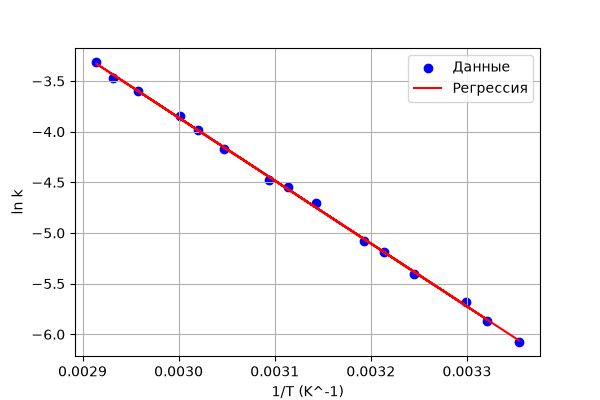

# Учебная проверка зависимости Аррениуса

Для 15 точек серий 2024-01, 2024-02, 2024-04 в диапазоне 25–70 °C выполнена
регрессия ln k = a+b/T; Ea=-Rb = **51.6625787854 кДж/моль**, R²≈0.9993.
Серия 2024-03 исключена из-за неисправности термостата согласно data/README.md.
Учебные аннотации [[Arrhenius 1889]] и [[Laidler 1984]] поясняют происхождение
модели и интерпретацию энергии активации, а не проверяют наши числа.

Двухточечная оценка по первой и последней отфильтрованным строкам даёт
51.3229 кДж/моль (разница около 0.66%); это приближённая проверка.
Отдельная реализация формулы наклона через суммы ковариации/дисперсии дала
51.66257878540774 кДж/моль, отличие от результата Goose 2.344791028e-13.
Высокий R² указывает на согласие этих данных с линейной моделью,
но не доказывает универсальную применимость закона.
Ошибки отдельных точек не заданы; доверительный интервал Ea здесь не оценён.

Расчёт Goose: `python src/calc_ea.py`; построение графика:
`python src/finalize_report.py`. Код построения сохраняется как журнал опыта:
его повторный запуск может переписать исправленные заметки, поэтому для
просмотра следует использовать готовые результаты.

Отчёт подготовлен Goose и исправлен Codex по поручению пользователя.
Ожидает личной проверки.

## Связи
- тип: [[Отчёт]]
- выполняет: [[Подготовить отчет по закону Аррениуса]]
- описывает: [[Расчёт энергии активации]]
- описывает: [[Результат Ea]]
- ссылаетсяНа: [[Arrhenius 1889]]
- ссылаетсяНа: [[Laidler 1984]]

Приёмка пользователя 20.10.2026: «Принимаю оба отчёта» (HOM и Аррениус).
