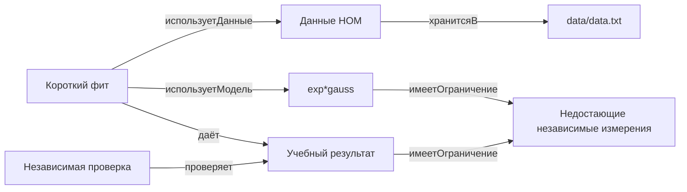

# Граф HOM после отдельного исправления Codex

Дата: 20.10.2026. Пользователь разрешил отдельное исправление заметок.
Первый проход Goose и его попытка исправления не прошли проверку; исходное
состояние сохранено в before/, полный экспорт — в logs/graph1-20261020-181201-3159d/.
Это не самостоятельный успешный опыт Goose.

Исправлены YAML, реальные пути, описания классов, задачи и настройки Obsidian.
Проверки и ontology.yaml не изменялись.
У класса Ограничение нет исходящих отношений; он связан входящими
имеетОграничение от моделей и результатов. Требование локального audit_graph.py
об исходящей связи у каждого объекта здесь не соответствует схеме.
Этот недостаток не исправляется вымышленной связью.

Числовая проверка подтверждает воспроизводимость, не истинность модели.
Личная сверка и приёмка ожидаются.

